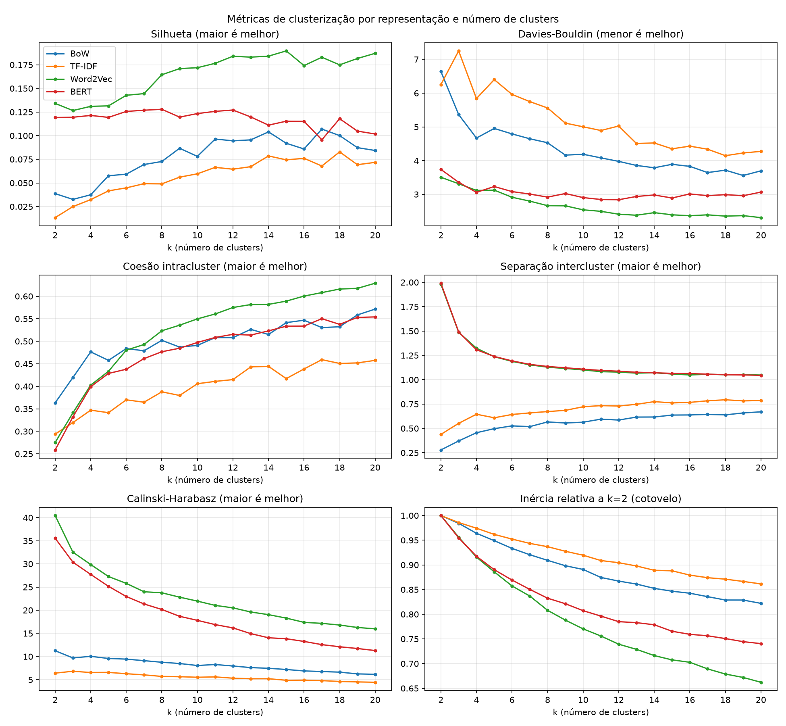
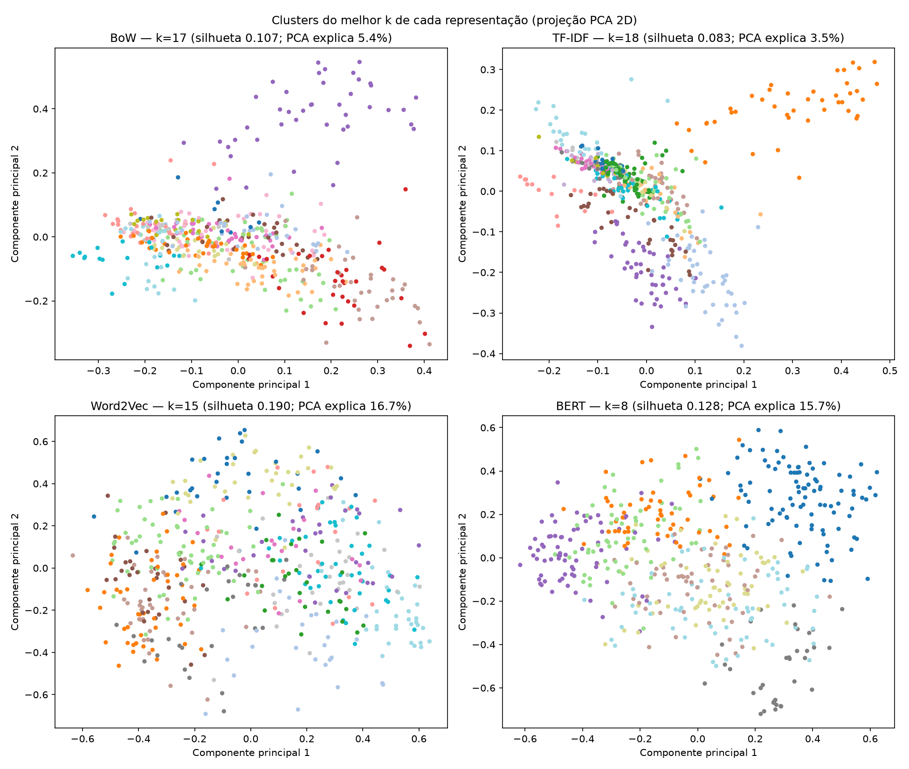
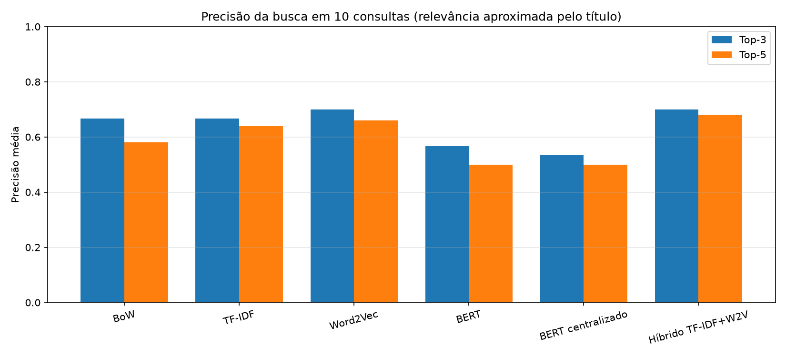
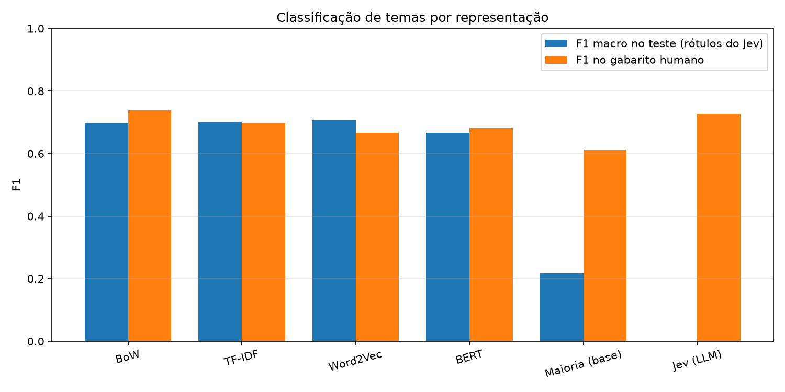
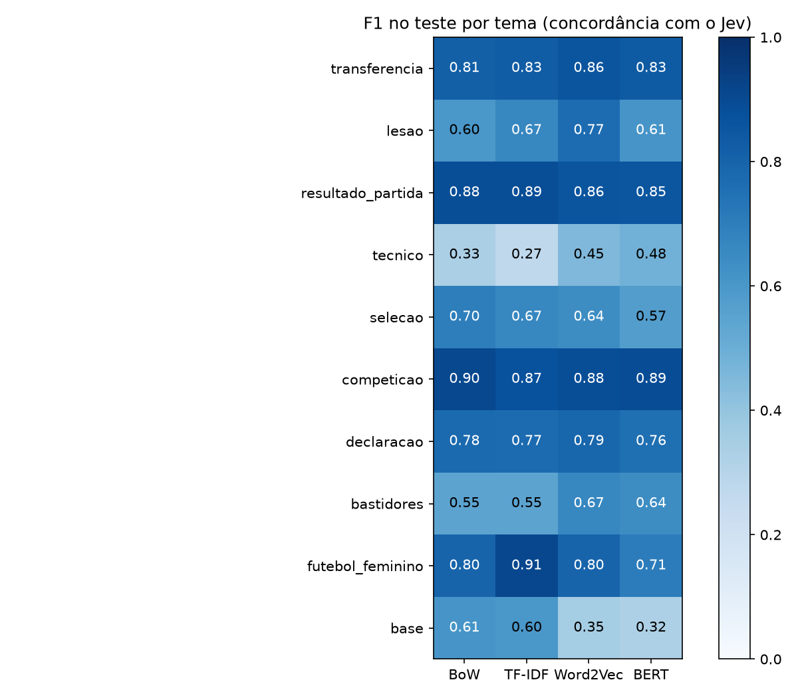
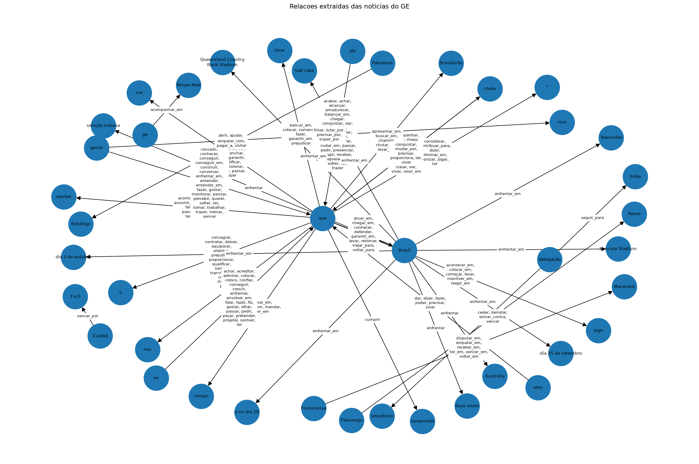

# Trabalho da Unidade 3 — Processamento de Linguagem Natural 2026/2

**Universidade Regional de Blumenau — Curso de Ciência da Computação**
**Equipe:** Henrique Olbrisch Soares
**Repositório:** https://github.com/HenriqueOS12/PLN

**Dados utilizados:** 500 notícias de futebol coletadas do portal ge.globo (setembro de 2026), pré-processadas com tokenização, normalização, remoção de stopwords, lematização e stemming (`scripts/processamento.py`). Todas as técnicas abaixo foram aplicadas às 500 notícias, salvo quando indicado o uso de amostra menor.

**Organização do repositório:** código em `scripts/`, dados em `dados/`, resultados em `resultados/<etapa>/` e este texto em `entrega/`.

---

## 1) Atividades realizadas

| | BoW | TF-IDF | Word2Vec | BERT |
|---|:---:|:---:|:---:|:---:|
| Clusterização + PCA e visualização | ✔ | ✔ | ✔ | ✔ |
| Busca e recomendação | ✔ | ✔ | ✔ | ✔ |
| Classificação | ✔ | ✔ | ✔ | ✔ |

- **Análise de sentimento:** ( ) Foi realizada (✔) Não foi realizada — as notícias são textos jornalísticos informativos, sem opinião explícita do autor sobre o assunto; a polaridade aparece apenas em trechos isolados (falas de jogadores, reação de torcida), o que tornaria uma análise de sentimento da notícia inteira pouco significativa. Ver discussão na questão 5.
- **Reconhecimento de Entidades Nomeadas:** (✔) Foi realizado ( ) Não foi realizado
- **Extração de Relações:** (✔) Foi realizada ( ) Não foi realizada

**Amostras menores utilizadas (explicitadas conforme as instruções):**
- Classificação: o gabarito humano tem 19 notícias rotuladas manualmente; o treino usa os rótulos de todas as 500 notícias gerados pelo modelo de linguagem Jev (questão 4).
- NER e dependências: as visualizações HTML mostram só as 10 primeiras notícias (os CSVs incluem as 500).
- Busca: a avaliação usa 10 consultas fixas.

---

## 2) Clusterização: qual representação gerou os clusters mais representativos?

**Como foi feito** (`scripts/clusterizacao_representacoes_ge.py`): as 500 notícias foram agrupadas com K-Means usando cada uma das quatro representações, testando de k = 2 a k = 20 clusters. Todas as matrizes foram normalizadas (norma 1), de modo que a distância usada pelo K-Means fique equivalente ao cosseno. Nos embeddings densos (Word2Vec e BERT) o vetor médio foi subtraído antes da normalização, porque eles apontavam quase todos na mesma direção (cosseno médio de 0,89 entre duas notícias quaisquer no BERT), o que esconde as diferenças entre notícias.

Métricas calculadas para cada representação e cada k:

| Tipo | Métrica | Interpretação |
|---|---|---|
| Intracluster | Coesão (cosseno médio entre cada notícia e o centro do seu cluster) | maior = notícias do grupo mais parecidas |
| Intracluster | Inércia (método do cotovelo) | queda mais lenta = ganho menor ao aumentar k |
| Intercluster | Separação (distância de cosseno média entre os centros) | maior = grupos mais diferentes entre si |
| Intra + inter | Silhueta | de −1 a 1; maior = grupos coesos e bem separados |
| Intra + inter | Davies-Bouldin | menor = melhor |
| Intra + inter | Calinski-Harabasz | maior = melhor |

```python
# Trecho de clusterizacao_representacoes_ge.py
kmeans = KMeans(n_clusters=k, random_state=RANDOM_STATE, n_init=10)
rotulos = kmeans.fit_predict(matriz)

metricas = {
    "coesao_media": np.mean(list(coesao.values())),                       # intracluster
    "separacao_media": separacao_entre_clusters(kmeans.cluster_centers_), # intercluster
    "silhueta": silhouette_score(matriz, rotulos, metric="cosine"),
    "davies_bouldin": davies_bouldin_score(matriz, rotulos),
}
```



**Melhor k de cada representação (maior silhueta):**

| Representação | Melhor k | Silhueta | Davies-Bouldin | Coesão média | Tamanho dos clusters |
|---|:---:|:---:|:---:|:---:|:---:|
| **Word2Vec** | **15** | **0,190** | **2,39** | **0,59** | 20 a 58 |
| BERT | 8 | 0,128 | 2,92 | 0,48 | 35 a 98 |
| BoW | 17 | 0,107 | 3,65 | 0,53 | 9 a 48 |
| TF-IDF | 18 | 0,083 | 4,15 | 0,45 | 7 a 68 |

**Interpretação das métricas.** O Word2Vec tem a maior silhueta e o menor Davies-Bouldin em praticamente todos os valores de k, ou seja, forma os grupos mais coesos e mais separados. Ainda assim, todas as silhuetas são baixas (abaixo de 0,2): os temas se sobrepõem — uma notícia sobre "Flamengo na Libertadores" pertence ao mesmo tempo ao grupo do clube e ao da competição. A inércia cai de forma contínua, sem um "cotovelo" nítido, o que é comum em texto. O Calinski-Harabasz favorece sempre k pequeno e, por isso, não foi usado para escolher k. A separação intercluster do Word2Vec e do BERT aparece inflada (próxima de 2 com k = 2) porque, depois de subtrair o vetor médio, dois centros ficam opostos por construção; essa métrica só é comparável entre valores de k de uma mesma representação.



A projeção PCA em duas dimensões explica pouco da variância (3,5 % no TF-IDF, cerca de 16 % no Word2Vec e no BERT), por isso a sobreposição visual é maior do que a real; a figura serve como ilustração, e as métricas são a evidência principal.

**Leitura dos textos (avaliação qualitativa).** Os termos mais fortes e as notícias mais centrais de cada cluster (`resultados/clusterizacao_representacoes/resumo_clusters.csv`) mostram dois comportamentos distintos:

- **BoW, TF-IDF e Word2Vec agrupam principalmente por clube ou competição.** No Word2Vec (k = 15) aparecem grupos claros como *Seleção/Ancelotti/convocação* (coesão 0,69), *Corinthians/Estudiantes/Diniz*, *futebol europeu (Barcelona, Real Madrid, Champions)*, *mercado do Botafogo/Ziyech*, *Séries B e C* e um grupo de *atuações e relatos de jogo* (tempo, bola, gol, ataque; coesão 0,73).
- **BERT agrupa por tipo de notícia, não por clube.** Com k = 8 os grupos correspondem a *transferências e valores*, *relato de partida*, *escalação e treino*, *declarações* (com "gente" vindo das citações), *seleção e prêmios*, *polêmicas com arbitragem* e *finanças/institucional*.

Essa diferença é confirmada pela concordância entre os agrupamentos (Adjusted Rand Index): BoW e TF-IDF concordam bastante entre si (0,56), mas o BERT quase não concorda com eles (0,05 a 0,08).

**Conclusão.** A representação que gerou clusters mais representativos foi o **Word2Vec**, tanto pelas métricas quanto pela leitura dos grupos. A quantidade de clusters que melhor expressou os dados ficou **entre 12 e 15**: a silhueta do Word2Vec sobe até k = 12 e se estabiliza, com pico em k = 15 — acima do k = 10 usado inicialmente (com k = 10 a silhueta do Word2Vec é 0,172). O BERT é uma alternativa útil quando o objetivo é organizar as notícias por gênero (transferência, relato, declaração) e não por clube.

---

## 3) Busca: qualidade dos top-3 e top-5

**Como foi feito** (`scripts/busca_representacoes_ge.py`): as mesmas 10 consultas foram executadas com as quatro representações, por similaridade de cosseno entre a consulta e cada notícia. Para responder como a busca pode ser melhorada, foram testadas duas variações: **BERT centralizado** (subtraindo o vetor médio) e uma **busca híbrida**, que soma as notas do TF-IDF (palavras exatas) e do Word2Vec (palavras de sentido próximo):

```python
# Trecho de busca_representacoes_ge.py
def buscar_hibrido(consulta):
    notas_tfidf = buscar_esparso(tfidf_vectorizer, matriz_tfidf, consulta)
    notas_w2v = buscar_word2vec(consulta)
    return (PESO_TFIDF_HIBRIDO * escala_0_1(notas_tfidf)
            + (1 - PESO_TFIDF_HIBRIDO) * escala_0_1(notas_w2v))
```

Para medir a qualidade, cada consulta recebeu um critério de relevância aproximado: a notícia é considerada relevante quando o **título** contém o assunto da consulta (por exemplo, "lesão", "lesões", "DM" para a consulta sobre lesão). É uma heurística automática, conferida manualmente em parte dos resultados, e não substitui um julgamento humano completo.



| Representação | Precisão top-3 | Precisão top-5 |
|---|:---:|:---:|
| **Híbrido TF-IDF + Word2Vec** | **0,70** | **0,68** |
| Word2Vec | 0,70 | 0,66 |
| TF-IDF | 0,67 | 0,64 |
| BoW | 0,67 | 0,58 |
| BERT | 0,57 | 0,50 |
| BERT centralizado | 0,53 | 0,50 |

**Análise crítica por tipo de consulta (exemplos reais):**

- **Nome de clube ou pessoa — "Corinthians".** BoW, TF-IDF, Word2Vec e o híbrido acertam os 5 primeiros resultados (ex.: *"Torcida vaia Corinthians após quarta derrota seguida no Brasileirão…"*). O BERT acerta só o primeiro e depois traz *"São Paulo x Santo Antônio-MS na Copa do Brasil Sub-20: onde assistir…"*, notícia que aparece no top-5 de 6 das 10 consultas originais — sinal de que os vetores do BERT ficam todos parecidos e algumas notícias "genéricas" ficam perto de tudo. Em "Cristiano Ronaldo", as representações lexicais chegam a 0,6 no top-5, que é o máximo possível: só três notícias da base tratam do jogador.
- **Consulta descritiva — "time perde clássico e torcida protesta".** BoW, TF-IDF e o híbrido não acertam nenhum resultado: trazem notícias de clássicos e de "onde assistir", porque dependem das palavras exatas. O **Word2Vec acerta o primeiro** (*"Torcida vaia Corinthians… e protesta: 'Time sem vergonha'"*) e o BERT encontra os protestos de Corinthians e Cruzeiro. É o caso em que as representações semânticas mostram vantagem.
- **Erro de digitação — "Corinthian".** BoW, TF-IDF e Word2Vec não retornam nada, pois a palavra não existe no vocabulário. Só o BERT encontra notícias do Corinthians, porque divide palavras desconhecidas em pedaços menores (subpalavras).
- **Consulta de serviço — "onde assistir ao vivo".** O híbrido atinge 0,8 no top-5, contra 0,6 do TF-IDF e 0,4 do Word2Vec sozinhos: a combinação recupera mais do que cada representação isolada.

**Top-3 x top-5.** O top-3 é sempre mais preciso: os primeiros resultados tendem a tratar diretamente do assunto, e as posições 4 e 5 trazem notícias apenas relacionadas (mesmo clube, mesma competição).

**Os resultados são utilizáveis em contexto real?** Com cerca de 70 % de acerto no top-3 nas melhores variações, a busca serve para **recomendação de "notícias relacionadas"**, em que um resultado parcialmente relacionado ainda é útil. Não é suficiente para uma busca em que o usuário precisa encontrar uma notícia específica sem revisão.

**Como combinar ou melhorar:**
- **Busca híbrida**, já testada: foi a melhor variação no top-5.
- **Filtros por metadados** (clube, competição, data), aproveitando as entidades extraídas na questão 5.
- **Correção ortográfica e expansão da consulta** antes da busca lexical.
- **Modelo de embeddings treinado para similaridade de frases** (sentence-transformers multilíngues) no lugar da média de vetores do BERTimbau. A centralização do BERT, que melhorou a clusterização, **não melhorou a busca**, o que indica que a limitação está no modelo — o BERTimbau não foi treinado para comparar textos — e não só na geometria dos vetores.

---

## 4) Classificação

**Foi possível treinar um classificador?** Sim. A primeira tentativa (`scripts/classificacao_tfidf_ge.py`) usou 20 notícias rotuladas manualmente em 10 temas (transferência, lesão, resultado de partida, técnico, seleção, competição, declaração, bastidores, futebol feminino e categorias de base), com TF-IDF e Regressão Logística. Com apenas 5 notícias de teste e temas que nem apareciam no teste, as métricas não eram confiáveis.

**Técnica com modelo de linguagem.** Para obter mais rótulos, as 500 notícias foram classificadas nos mesmos 10 temas pelo **Jev**, um modelo de linguagem acessado por API (`scripts/jev_ge.py`), que responde a cada pergunta temática com uma probabilidade. Esses rótulos foram usados para treinar classificadores próprios — uma estratégia conhecida como **rotulagem fraca** (*weak supervision*) ou destilação: o modelo de linguagem, grande e caro, gera os rótulos, e modelos pequenos e locais aprendem a reproduzi-los. O classificador é uma **Regressão Logística** por tema (modelo de decisão linear), com `class_weight="balanced"` para compensar temas com poucos exemplos (`scripts/classificacao_representacoes_ge.py`).

```python
# Trecho de classificacao_representacoes_ge.py
Y_jev = np.column_stack([
    jev.loc[df["url"], f"jev_tema_{tema}"].str.lower().eq("sim").astype(int)
    for tema in TEMAS
])

modelo = LogisticRegression(max_iter=2000, class_weight="balanced", random_state=RANDOM_STATE)
modelo.fit(X[indices_treino], Y_jev[indices_treino, posicao])
```

**Divisão dos dados:**
- **Gabarito humano (dados novos):** 19 notícias rotuladas manualmente, mantidas **fora do treino**.
- **Treino e teste:** as outras 481 notícias, com 384 para treino e 97 para teste, rotuladas pelo Jev.
- **Linha de base:** um classificador que sempre responde a classe mais frequente.



| Representação | F1 macro no teste (concordância com o Jev) | F1 no gabarito humano |
|---|:---:|:---:|
| Word2Vec | **0,707** | 0,667 |
| TF-IDF | 0,702 | 0,698 |
| BoW | 0,696 | **0,739** |
| BERT | 0,666 | 0,681 |
| Jev (o próprio modelo de linguagem) | — | 0,727 |
| Linha de base (classe mais frequente) | 0,217 | 0,612 |

**Por que F1 e não acurácia.** A acurácia engana em temas desbalanceados: em "técnico", responder sempre "não" acerta 88,7 % das notícias de teste e supera todos os classificadores, sem nunca identificar uma notícia sobre técnico. O F1 da classe "sim" mostra a diferença real: 0,22 da linha de base contra 0,67 a 0,71 dos classificadores.



**Alguma representação favorece classificações mais precisas?** No conjunto, não há vencedora clara: Word2Vec, TF-IDF e BoW ficam praticamente empatados e o BERT um pouco abaixo — o mesmo padrão observado na busca. Por tema, há diferenças com explicação:
- O **Word2Vec** vai melhor em temas descritos por palavras variadas, como lesão (F1 0,77 contra 0,60 do BoW) e bastidores.
- **BoW e TF-IDF** vão melhor em categorias de base (0,61 contra 0,35 do Word2Vec), tema marcado por termos exatos como "sub-20" e "sub-17", que a média de vetores dilui.
- O tema **técnico** é o mais difícil para todos (F1 de 0,27 a 0,48): é também um dos temas em que o Jev mais hesita, com 52 notícias de probabilidade entre 0,3 e 0,7.

**Como se comportou com dados novos?** No gabarito humano, os classificadores acertam praticamente tanto quanto o próprio Jev (F1 de 0,67 a 0,74, contra 0,73 do Jev): um modelo pequeno e local reproduz o modelo de linguagem quase sem perda. Porém, com apenas 19 notícias, essas diferenças **não são estatisticamente confiáveis**, e alguns temas (técnico, futebol feminino) nem aparecem no gabarito. A principal limitação observada é que **os classificadores herdam os erros do Jev**: o Jev marca "categorias de base" em notícias como *"Zagueiro Jair Cunha celebra primeira convocação para a Seleção"* e *"Ex-Grêmio, Kaick vive ascensão na MLS"*, e os classificadores repetem o erro. Para uso real, seria necessário ampliar o gabarito humano e revisar os rótulos do Jev nos temas de maior incerteza (competição, bastidores e técnico).

---

## 5) Análise de sentimentos, entidades nomeadas e extração de relações

**Análise de sentimentos — não realizada.** Não é aplicável à notícia como um todo: os textos são informativos e escritos em tom neutro. Haveria aplicação parcial em trechos opinativos — falas de jogadores e técnicos, reação de torcedores, como em *"Torcida vaia Corinthians… e protesta: 'Time sem vergonha'"* —, mas isso exigiria primeiro separar as citações do texto jornalístico, o que ficou fora do escopo.

**Reconhecimento de entidades nomeadas — aplicável e realizado** (`scripts/parsing_ner_relacoes_ge.py`, modelo `pt_core_news_sm` do spaCy):

| | Quantidade |
|---|:---:|
| Notícias / tokens analisados | 500 / 244.096 |
| Entidades reconhecidas | 21.928 |
| Organizações (ORG) | 7.030 |
| Pessoas (PER) | 6.097 |
| Locais (LOC) | 5.161 |
| Outras (MISC) | 3.640 |

As entidades mais frequentes são coerentes com o domínio: Corinthians (466), Palmeiras (463), Vasco (457), Flamengo (437), Fluminense (395), São Paulo (356), Botafogo (329), Libertadores (313) e Brasileirão (216).

**Limpeza de ruído.** A primeira execução reconhecia como entidades elementos que não fazem parte da notícia, e o pré-processamento foi corrigido:

| Ruído | Antes | Depois |
|---|:---:|:---:|
| Entidade "Texto", vinda do rótulo "Texto da noticia:" que o script inseria | 301 | 0 |
| Relações contendo os rótulos "Titulo:"/"Texto da noticia:" | 441 | 0 |
| Entidade "Foto", vinda das legendas de imagem coletadas no scraping | 188 | 0 |
| Nomes de fotógrafos e agências reconhecidos como entidades | 171 | 5 |

```python
# Trecho de parsing_ner_relacoes_ge.py: remove "— Foto: <crédito>" antes do NER
texto = PADRAO_LEGENDA_FOTO.sub(". ", texto)
```

Um efeito interessante: após a limpeza, a contagem de alguns clubes **subiu** (Corinthians de 447 para 466), porque o modelo deixou de juntar o nome do clube ao rótulo "Titulo:" no início do texto. O ruído não só criava entidades falsas, como também escondia entidades verdadeiras.

**Extração de relações — aplicável, com limitações.** As relações foram extraídas por regras sobre a árvore de dependências (sujeito → verbo/preposição → objeto), gerando 13.534 triplas e um grafo com 10.346 nós (`noticias_ge_relacoes.gexf`, que pode ser aberto no Gephi). Exemplos corretos: *Palmeiras → empatar_com → Botafogo*, *Cuiabá → vencer_por → 3 a 0*, *Lucho Acosta → comemorar_contra → Vasco*.



Limitações observadas:
- **Pronomes como sujeito.** Os nós mais conectados do grafo são "que" e "ele", porque o script não resolve correferência.
- **Relações repetidas.** *Brasil → enfrentar → Austrália* aparece 10 vezes porque 20 notícias diferentes sobre a Seleção repetem o mesmo parágrafo padrão.
- **Créditos longos.** Créditos de foto com mais de dois nomes ainda deixam resíduos pequenos.

Mesmo assim, entidades e relações permitem identificar quem enfrenta quem, quem foi contratado e quem se lesionou, e representar essas conexões em grafo.

---

## 6) Contribuição para o projeto da Unidade 1

O projeto da Unidade 1 propõe um sistema de **pesquisa, navegação e recomendação**. As técnicas estudadas contribuem diretamente para cada parte desse sistema:

- **Recomendação de notícias relacionadas.** A busca por similaridade é a base dessa funcionalidade. A combinação TF-IDF + Word2Vec foi a mais precisa, com 70 % de acerto no top-3 (questão 3).
- **Navegação por assunto.** A clusterização com Word2Vec (12 a 15 grupos) gera agrupamentos que um leitor reconhece: Seleção, futebol europeu, mercado da bola e grupos por clube. Com BERT, os grupos seguem o tipo de notícia, o que permite outra forma de organizar o conteúdo (questão 2).
- **Filtros por tema.** Os classificadores treinados com os rótulos do Jev etiquetam cada notícia em 10 temas, com F1 próximo de 0,7 e custo baixo de execução (questão 4).
- **Filtros por clube, jogador e competição.** O NER identifica essas entidades com boa precisão após a limpeza, e o grafo de relações pode alimentar uma visualização de "quem enfrenta quem" (questão 5).

Os resultados mostram que essas funcionalidades são viáveis, mas ainda como **prova de conceito**. Para chegar a um sistema real, seria necessário:
- coletar notícias continuamente, ampliando a base além de 500;
- aumentar o gabarito humano, hoje com 19 notícias, para avaliar com confiança a classificação e o próprio Jev;
- usar um modelo de embeddings treinado para similaridade de frases;
- tratar a correferência na extração de relações.

---

## Declaração de uso de IA generativa

Conforme as instruções do trabalho, foram utilizadas as seguintes ferramentas de IA generativa:

**1. ChatGPT (OpenAI)** . Não tenho os prompts mas ele foi usado apenas no início do projeto, porque depois mudei para o Claude, enfim usei ele para correção de erros, revisão e organização do código.

**2. Claude (Anthropic), modelo Claude Opus 5.5, via Claude Code (aplicativo desktop).** Usado para:
- organizar o repositório em pastas;
- diagnosticar e corrigir problemas (HTMLs grandes demais, texto cortado nos gráficos, ruído do NER, arquivo acima do limite do GitHub);
- analisar os resultados;
- estava tendo problema para commitar, tive que pedir para ele também;

Todo o conteúdo foi revisado pelo autor. Principais prompts utilizados (transcritos da conversa):
- "primeiro quero que vc leia o meu projeto de pln, entenda-o e guarde na memória o que vc entendeu"
- "esse meu trabalho de pln está meio bagunçado, gostaria que vc organizasse ele em pastas, e obviamente corrigisse as referencias de caminhos no código para os novos caminhos"
- "gerei os clusters pro 500 tbm quero q veja se veio tudo certinho, pelo que eu vi tanto o 2d e o 3d parecem certos, porém eu não estou conseguindo ler o texto inteiro de cada item"